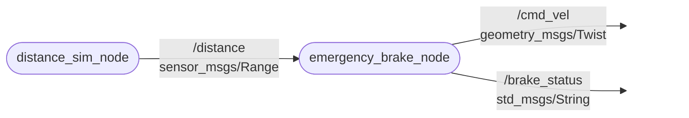

# `ben_d91_autonom` package

ROS 2 C++ package: szimulált távolságszenzor és vészfékező logika. [](https://docs.ros.org/en/humble/)

Az *Autonóm járművek és robotok programozása* kis beadandója.

## Mit csinál?

A package két node-ból áll:

- `distance_sim_node`: egy közeledő, majd távolodó akadályt szimulál. A távolságot szinuszos hullámként állítja elő (alapból 0,3 m és 5 m között, 10 s periódussal), és `sensor_msgs/msg/Range` típusú üzenetként hirdeti a `/distance` topicban 10 Hz-en.
- `emergency_brake_node`: feliratkozik a `/distance` topicra és sebességparancsot számol:
  - `d > slow_distance`: szabad haladás (`FREE`), `cruise_speed` sebességgel
  - `stop_distance < d <= slow_distance`: lineáris lassítás (`SLOW`)
  - `d <= stop_distance`: megállás (`STOP`)

  A sebességet `geometry_msgs/msg/Twist` típusként a `/cmd_vel` topicban, az állapotot `std_msgs/msg/String` típusként a `/brake_status` topicban hirdeti.

## Node-ok és topic-ok kapcsolata



## Paraméterek

| Node | Paraméter | Alapérték | Jelentés |
|---|---|---|---|
| `distance_sim_node` | `min_distance` | 0.3 | minimális szimulált távolság [m] |
| `distance_sim_node` | `max_distance` | 5.0 | maximális szimulált távolság [m] |
| `distance_sim_node` | `period` | 10.0 | egy teljes ciklus ideje [s] |
| `emergency_brake_node` | `cruise_speed` | 1.0 | haladási sebesség [m/s] |
| `emergency_brake_node` | `slow_distance` | 2.0 | ennél közelebb lassítani kezd [m] |
| `emergency_brake_node` | `stop_distance` | 1.0 | ennél közelebb megáll [m] |

## Packages and build

It is assumed that the workspace is `~/ros2_ws/`.

### Clone the packages

```bash
cd ~/ros2_ws/src
git clone https://github.com/D91GG4/ben_d91_autonom
```

### Build ROS 2 packages

```bash
cd ~/ros2_ws
colcon build --packages-select ben_d91_autonom --symlink-install
```

**Don't forget to source before ROS commands.**

```bash
source ~/ros2_ws/install/setup.bash
```

### Futtatás

Mindkét node egyszerre, launch fájllal:

```bash
ros2 launch ben_d91_autonom launch_example1.launch.py
```

Vagy külön terminálban, node-onként:

```bash
ros2 run ben_d91_autonom distance_sim_node
ros2 run ben_d91_autonom emergency_brake_node
```

Paraméter módosítása futtatáskor:

```bash
ros2 run ben_d91_autonom emergency_brake_node --ros-args -p stop_distance:=1.5
```

### Ellenőrzés

Egy másik terminálban (source után):

```bash
ros2 topic list
ros2 topic echo /brake_status
ros2 topic echo /cmd_vel
ros2 node info /emergency_brake_node
rqt_graph
```

A `/brake_status` kimenete a szinuszos távolság miatt ciklikusan `FREE` → `SLOW` → `STOP` → `SLOW` → `FREE` értékeket vesz fel, a `/cmd_vel` `linear.x` értéke pedig ennek megfelelően 1.0 és 0.0 között változik.

## Fájlok

```
ben_d91_autonom/
├── CMakeLists.txt
├── package.xml
├── README.md
├── launch/
│   └── launch_example1.launch.py
└── src/
    ├── distance_sim_node.cpp
    └── emergency_brake_node.cpp
```
